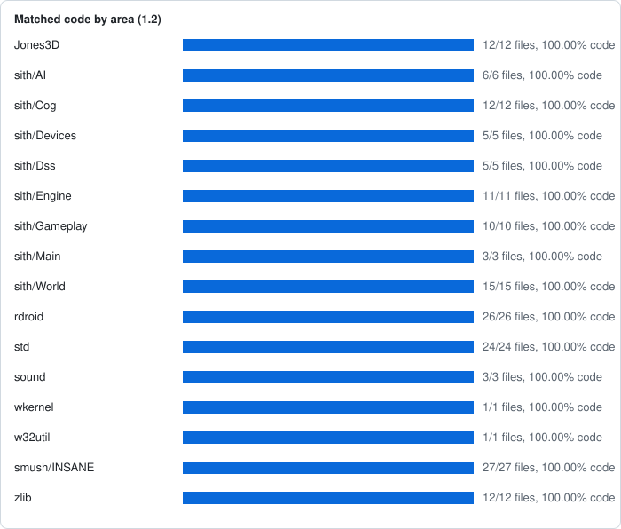

# Byte breakdown

Only 83.63% of the rebuilt `Indy3D.exe` is compiled from the source code in this repository. The rest is
pieces that never came out of a compiler at LucasArts:

- **Generated parts** *(the headers, import tables and resources)*, which the build writes from checked-in
  descriptions.
- **Library code** that LucasArts linked in already compiled, from Microsoft's C runtime and DirectInput. The build
  takes it unmodified from the same libraries.
- **The icons**, which are LucasArts' copyrighted artwork, so the build copies them from the retail executable
  *(you supply your own copy; it isn't included here)*.
- **A little more library code, and some unused bytes**, which the build also copies from the retail executable.

| | Bytes | |
| --- | ---: | ---: |
| Compiled from this repository's source | 1,287,199 | 83.63% |
| Generated headers, import tables and resources | 26,289 | 1.71% |
| C runtime and DirectInput code, taken unmodified from the libraries LucasArts linked | 75,781 | 4.92% |
| The icons, copied from the retail executable | 147,176 | 9.56% |
| Library code the build can't take from the libraries we have, and unused bytes, copied from the retail executable | 2,627 | 0.17% |
| **Total** | 1,539,072 | 100.00% |

That last row is mostly library code, but code the build can't take from the libraries we have:

- **Intel's maths library** *(`floor`, `modf` and a few statics)*: our copy of Intel's library differs slightly from
  the one LucasArts linked. We reconstructed `floor` and `modf` in C anyway, in case a port needs them, but couldn't
  get their constants in the same order.
- **Three C runtime string helpers and `longjmp`**: identical in our copy of the C runtime, but each brings a few bytes
  of data that nothing in the game lets the build place.
- **Unused bytes**: a few constants and zero-filled gaps that nothing in the game ever reads.

So the build copies these bytes from the retail executable instead
([details](DECISIONS.md#10-library-code-taken-from-the-original)).

The game's own code is all byte-exact:

| | |
| --- | ---: |
| Source files byte-exact | 173 of 173 |
| Functions byte-exact | 3,300 of 3,300 |
| Code byte-exact | 974,387 of 974,387 bytes |

Figures are for 1.2; both versions are below.

## Progress by area and file

Generated from the development repository's builds (commit `319a6fc22c`). Function and code figures are [objdiff](https://github.com/encounter/objdiff)'s per-function scores (a guide); a **Matching** file is verified whole by the build (code, data and BSS identical after relocation).

| | 1.2 (default build) | 1.0 |
| --- | ---: | ---: |
| Matching source files | 173 of 173 | 173 of 173 |
| Exact functions | 3,300 of 3,300 | 3,300 of 3,300 |
| Matched code | 974,387 of 974,387 bytes (100.00%) | 974,598 of 974,598 bytes (100.00%) |
| Fuzzy match | 100.00% | 100.00% |

The areas and files below are 1.2, the default build; [1.0](#version-10) lists only the files whose figures differ.

| Area | Matching files | Exact functions | Matched code | Fuzzy |
| --- | ---: | ---: | ---: | ---: |
| [Jones3D](#jones3d) | 12/12 | 380/380 | 100.00% | 100.00% |
| [sith/AI](#sithai) | 6/6 | 175/175 | 100.00% | 100.00% |
| [sith/Cog](#sithcog) | 12/12 | 659/659 | 100.00% | 100.00% |
| [sith/Devices](#sithdevices) | 5/5 | 92/92 | 100.00% | 100.00% |
| [sith/Dss](#sithdss) | 5/5 | 126/126 | 100.00% | 100.00% |
| [sith/Engine](#sithengine) | 11/11 | 276/276 | 100.00% | 100.00% |
| [sith/Gameplay](#sithgameplay) | 10/10 | 218/218 | 100.00% | 100.00% |
| [sith/Main](#sithmain) | 3/3 | 43/43 | 100.00% | 100.00% |
| [sith/World](#sithworld) | 15/15 | 308/308 | 100.00% | 100.00% |
| [rdroid](#rdroid) | 26/26 | 231/231 | 100.00% | 100.00% |
| [std](#std) | 24/24 | 289/289 | 100.00% | 100.00% |
| [sound](#sound) | 3/3 | 117/117 | 100.00% | 100.00% |
| [wkernel](#wkernel) | 1/1 | 8/8 | 100.00% | 100.00% |
| [w32util](#w32util) | 1/1 | 10/10 | 100.00% | 100.00% |
| [smush/INSANE](#smushinsane) | 27/27 | 300/300 | 100.00% | 100.00% |
| [zlib](#zlib) | 12/12 | 68/68 | 100.00% | 100.00% |
| **All source** | **173/173** | **3300/3300** | **100.00%** | **100.00%** |

### Jones3D

12 of 12 files matching; 380 of 380 functions exact; 100.00% of 131,252 code bytes matched.

| File | Status | Exact functions | Matched code | Fuzzy |
| --- | --- | ---: | ---: | ---: |
| `Jones3D/Display/jonesConfig.c` | Matching | 144/144 | 100.00% | 100.00% |
| `Jones3D/Display/JonesConsole.c` | Matching | 18/18 | 100.00% | 100.00% |
| `Jones3D/Display/JonesDisplay.c` | Matching | 11/11 | 100.00% | 100.00% |
| `Jones3D/Display/JonesHud.c` | Matching | 62/62 | 100.00% | 100.00% |
| `Jones3D/Gui/JonesDialog.c` | Matching | 21/21 | 100.00% | 100.00% |
| `Jones3D/Main/JonesDevDialog.c` | Matching | 9/9 | 100.00% | 100.00% |
| `Jones3D/Main/JonesFile.c` | Matching | 22/22 | 100.00% | 100.00% |
| `Jones3D/Main/JonesMain.c` | Matching | 56/56 | 100.00% | 100.00% |
| `Jones3D/Main/jonesString.c` | Matching | 3/3 | 100.00% | 100.00% |
| `Jones3D/Play/jonesCog.c` | Matching | 15/15 | 100.00% | 100.00% |
| `Jones3D/Play/JonesControl.c` | Matching | 4/4 | 100.00% | 100.00% |
| `Jones3D/Play/jonesInventory.c` | Matching | 15/15 | 100.00% | 100.00% |

### sith/AI

6 of 6 files matching; 175 of 175 functions exact; 100.00% of 79,832 code bytes matched.

| File | Status | Exact functions | Matched code | Fuzzy |
| --- | --- | ---: | ---: | ---: |
| `Libs/sith/AI/sithAI.c` | Matching | 27/27 | 100.00% | 100.00% |
| `Libs/sith/AI/sithAIAwareness.c` | Matching | 9/9 | 100.00% | 100.00% |
| `Libs/sith/AI/sithAIClass.c` | Matching | 12/12 | 100.00% | 100.00% |
| `Libs/sith/AI/sithAIInstinct.c` | Matching | 29/29 | 100.00% | 100.00% |
| `Libs/sith/AI/sithAIMove.c` | Matching | 45/45 | 100.00% | 100.00% |
| `Libs/sith/AI/sithAIUtil.c` | Matching | 53/53 | 100.00% | 100.00% |

### sith/Cog

12 of 12 files matching; 659 of 659 functions exact; 100.00% of 121,413 code bytes matched.

| File | Status | Exact functions | Matched code | Fuzzy |
| --- | --- | ---: | ---: | ---: |
| `Libs/sith/Cog/sithCog.c` | Matching | 48/48 | 100.00% | 100.00% |
| `Libs/sith/Cog/sithCogExec.c` | Matching | 42/42 | 100.00% | 100.00% |
| `Libs/sith/Cog/sithCogFlex.c` | Matching | 8/8 | 100.00% | 100.00% |
| `Libs/sith/Cog/sithCogFunction.c` | Matching | 134/134 | 100.00% | 100.00% |
| `Libs/sith/Cog/sithCogFunctionAI.c` | Matching | 60/60 | 100.00% | 100.00% |
| `Libs/sith/Cog/sithCogFunctionPlayer.c` | Matching | 40/40 | 100.00% | 100.00% |
| `Libs/sith/Cog/sithCogFunctionSector.c` | Matching | 25/25 | 100.00% | 100.00% |
| `Libs/sith/Cog/sithCogFunctionSound.c` | Matching | 17/17 | 100.00% | 100.00% |
| `Libs/sith/Cog/sithCogFunctionSurface.c` | Matching | 38/38 | 100.00% | 100.00% |
| `Libs/sith/Cog/sithCogFunctionThing.c` | Matching | 216/216 | 100.00% | 100.00% |
| `Libs/sith/Cog/sithCogParse.c` | Matching | 29/29 | 100.00% | 100.00% |
| `Libs/sith/Cog/sithCogYacc.c` | Matching | 2/2 | 100.00% | 100.00% |

### sith/Devices

5 of 5 files matching; 92 of 92 functions exact; 100.00% of 12,401 code bytes matched.

| File | Status | Exact functions | Matched code | Fuzzy |
| --- | --- | ---: | ---: | ---: |
| `Libs/sith/Devices/sithComm.c` | Matching | 15/15 | 100.00% | 100.00% |
| `Libs/sith/Devices/sithConsole.c` | Matching | 12/12 | 100.00% | 100.00% |
| `Libs/sith/Devices/sithControl.c` | Matching | 25/25 | 100.00% | 100.00% |
| `Libs/sith/Devices/sithSound.c` | Matching | 12/12 | 100.00% | 100.00% |
| `Libs/sith/Devices/sithSoundMixer.c` | Matching | 28/28 | 100.00% | 100.00% |

### sith/Dss

5 of 5 files matching; 126 of 126 functions exact; 100.00% of 38,283 code bytes matched.

| File | Status | Exact functions | Matched code | Fuzzy |
| --- | --- | ---: | ---: | ---: |
| `Libs/sith/Dss/sithDSS.c` | Matching | 26/26 | 100.00% | 100.00% |
| `Libs/sith/Dss/sithDSSCog.c` | Matching | 4/4 | 100.00% | 100.00% |
| `Libs/sith/Dss/sithDSSThing.c` | Matching | 39/39 | 100.00% | 100.00% |
| `Libs/sith/Dss/sithGamesave.c` | Matching | 27/27 | 100.00% | 100.00% |
| `Libs/sith/Dss/sithMulti.c` | Matching | 30/30 | 100.00% | 100.00% |

### sith/Engine

11 of 11 files matching; 276 of 276 functions exact; 100.00% of 142,358 code bytes matched.

| File | Status | Exact functions | Matched code | Fuzzy |
| --- | --- | ---: | ---: | ---: |
| `Libs/sith/Engine/sithAnimate.c` | Matching | 50/50 | 100.00% | 100.00% |
| `Libs/sith/Engine/sithCamera.c` | Matching | 26/26 | 100.00% | 100.00% |
| `Libs/sith/Engine/sithCollision.c` | Matching | 27/27 | 100.00% | 100.00% |
| `Libs/sith/Engine/sithIntersect.c` | Matching | 11/11 | 100.00% | 100.00% |
| `Libs/sith/Engine/sithParticle.c` | Matching | 13/13 | 100.00% | 100.00% |
| `Libs/sith/Engine/sithPathMove.c` | Matching | 14/14 | 100.00% | 100.00% |
| `Libs/sith/Engine/sithPhysics.c` | Matching | 47/47 | 100.00% | 100.00% |
| `Libs/sith/Engine/sithPuppet.c` | Matching | 56/56 | 100.00% | 100.00% |
| `Libs/sith/Engine/sithRender.c` | Matching | 23/23 | 100.00% | 100.00% |
| `Libs/sith/Engine/sithRenderSky.c` | Matching | 4/4 | 100.00% | 100.00% |
| `Libs/sith/Engine/sithShadow.c` | Matching | 5/5 | 100.00% | 100.00% |

### sith/Gameplay

10 of 10 files matching; 218 of 218 functions exact; 100.00% of 94,125 code bytes matched.

| File | Status | Exact functions | Matched code | Fuzzy |
| --- | --- | ---: | ---: | ---: |
| `Libs/sith/Gameplay/sithEvent.c` | Matching | 12/12 | 100.00% | 100.00% |
| `Libs/sith/Gameplay/sithFX.c` | Matching | 23/23 | 100.00% | 100.00% |
| `Libs/sith/Gameplay/sithInventory.c` | Matching | 32/32 | 100.00% | 100.00% |
| `Libs/sith/Gameplay/sithOverlayMap.c` | Matching | 21/21 | 100.00% | 100.00% |
| `Libs/sith/Gameplay/sithPlayer.c` | Matching | 17/17 | 100.00% | 100.00% |
| `Libs/sith/Gameplay/sithPlayerActions.c` | Matching | 42/42 | 100.00% | 100.00% |
| `Libs/sith/Gameplay/sithPlayerControls.c` | Matching | 28/28 | 100.00% | 100.00% |
| `Libs/sith/Gameplay/sithTime.c` | Matching | 6/6 | 100.00% | 100.00% |
| `Libs/sith/Gameplay/sithVehicleControls.c` | Matching | 17/17 | 100.00% | 100.00% |
| `Libs/sith/Gameplay/sithWhip.c` | Matching | 20/20 | 100.00% | 100.00% |

### sith/Main

3 of 3 files matching; 43 of 43 functions exact; 100.00% of 5,874 code bytes matched.

| File | Status | Exact functions | Matched code | Fuzzy |
| --- | --- | ---: | ---: | ---: |
| `Libs/sith/Main/sithCommand.c` | Matching | 10/10 | 100.00% | 100.00% |
| `Libs/sith/Main/sithMain.c` | Matching | 30/30 | 100.00% | 100.00% |
| `Libs/sith/Main/sithString.c` | Matching | 3/3 | 100.00% | 100.00% |

### sith/World

15 of 15 files matching; 308 of 308 functions exact; 100.00% of 99,208 code bytes matched.

| File | Status | Exact functions | Matched code | Fuzzy |
| --- | --- | ---: | ---: | ---: |
| `Libs/sith/World/sithActor.c` | Matching | 12/12 | 100.00% | 100.00% |
| `Libs/sith/World/sithExplosion.c` | Matching | 7/7 | 100.00% | 100.00% |
| `Libs/sith/World/sithItem.c` | Matching | 5/5 | 100.00% | 100.00% |
| `Libs/sith/World/sithMaterial.c` | Matching | 12/12 | 100.00% | 100.00% |
| `Libs/sith/World/sithModel.c` | Matching | 17/17 | 100.00% | 100.00% |
| `Libs/sith/World/sithPVS.c` | Matching | 4/4 | 100.00% | 100.00% |
| `Libs/sith/World/sithSector.c` | Matching | 19/19 | 100.00% | 100.00% |
| `Libs/sith/World/sithSoundClass.c` | Matching | 25/25 | 100.00% | 100.00% |
| `Libs/sith/World/sithSprite.c` | Matching | 15/15 | 100.00% | 100.00% |
| `Libs/sith/World/sithSurface.c` | Matching | 20/20 | 100.00% | 100.00% |
| `Libs/sith/World/sithTemplate.c` | Matching | 16/16 | 100.00% | 100.00% |
| `Libs/sith/World/sithThing.c` | Matching | 65/65 | 100.00% | 100.00% |
| `Libs/sith/World/sithVoice.c` | Matching | 20/20 | 100.00% | 100.00% |
| `Libs/sith/World/sithWeapon.c` | Matching | 48/48 | 100.00% | 100.00% |
| `Libs/sith/World/sithWorld.c` | Matching | 23/23 | 100.00% | 100.00% |

### rdroid

26 of 26 files matching; 231 of 231 functions exact; 100.00% of 92,020 code bytes matched.

| File | Status | Exact functions | Matched code | Fuzzy |
| --- | --- | ---: | ---: | ---: |
| `Libs/rdroid/Engine/rdCamera.c` | Matching | 26/26 | 100.00% | 100.00% |
| `Libs/rdroid/Engine/rdCanvas.c` | Matching | 4/4 | 100.00% | 100.00% |
| `Libs/rdroid/Engine/rdClip.c` | Matching | 17/17 | 100.00% | 100.00% |
| `Libs/rdroid/Engine/rdClipFace.c` | Matching | 3/3 | 100.00% | 100.00% |
| `Libs/rdroid/Engine/rdKeyframe.c` | Matching | 4/4 | 100.00% | 100.00% |
| `Libs/rdroid/Engine/rdLight.c` | Matching | 4/4 | 100.00% | 100.00% |
| `Libs/rdroid/Engine/rdMaterial.c` | Matching | 7/7 | 100.00% | 100.00% |
| `Libs/rdroid/Engine/rdPuppet.c` | Matching | 15/15 | 100.00% | 100.00% |
| `Libs/rdroid/Engine/rdQClip.c` | Matching | 2/2 | 100.00% | 100.00% |
| `Libs/rdroid/Engine/rdThing.c` | Matching | 10/10 | 100.00% | 100.00% |
| `Libs/rdroid/Main/rdroid.c` | Matching | 10/10 | 100.00% | 100.00% |
| `Libs/rdroid/Math/rdMath.c` | Matching | 2/2 | 100.00% | 100.00% |
| `Libs/rdroid/Math/rdMatrix.c` | Matching | 25/25 | 100.00% | 100.00% |
| `Libs/rdroid/Math/rdVector.c` | Matching | 13/13 | 100.00% | 100.00% |
| `Libs/rdroid/Primitives/rdFont.c` | Matching | 14/14 | 100.00% | 100.00% |
| `Libs/rdroid/Primitives/rdModel3.c` | Matching | 19/19 | 100.00% | 100.00% |
| `Libs/rdroid/Primitives/rdModel3K.c` | Matching | 5/5 | 100.00% | 100.00% |
| `Libs/rdroid/Primitives/rdModel3K_cpu.c` | Matching | 6/6 | 100.00% | 100.00% |
| `Libs/rdroid/Primitives/rdParticle.c` | Matching | 7/7 | 100.00% | 100.00% |
| `Libs/rdroid/Primitives/rdPolyline.c` | Matching | 6/6 | 100.00% | 100.00% |
| `Libs/rdroid/Primitives/rdPrimit2.c` | Matching | 5/5 | 100.00% | 100.00% |
| `Libs/rdroid/Primitives/rdPrimit3.c` | Matching | 2/2 | 100.00% | 100.00% |
| `Libs/rdroid/Primitives/rdSprite.c` | Matching | 3/3 | 100.00% | 100.00% |
| `Libs/rdroid/Primitives/rdWallpaper.c` | Matching | 6/6 | 100.00% | 100.00% |
| `Libs/rdroid/Raster/rdCache.c` | Matching | 14/14 | 100.00% | 100.00% |
| `Libs/rdroid/Raster/rdFace.c` | Matching | 2/2 | 100.00% | 100.00% |

### std

24 of 24 files matching; 289 of 289 functions exact; 100.00% of 52,991 code bytes matched.

| File | Status | Exact functions | Matched code | Fuzzy |
| --- | --- | ---: | ---: | ---: |
| `Libs/std/General/std.c` | Matching | 6/6 | 100.00% | 100.00% |
| `Libs/std/General/stdBmp.c` | Matching | 2/2 | 100.00% | 100.00% |
| `Libs/std/General/stdCircBuf.c` | Matching | 4/4 | 100.00% | 100.00% |
| `Libs/std/General/stdColor.c` | Matching | 1/1 | 100.00% | 100.00% |
| `Libs/std/General/stdConffile.c` | Matching | 15/15 | 100.00% | 100.00% |
| `Libs/std/General/stdEffect.c` | Matching | 4/4 | 100.00% | 100.00% |
| `Libs/std/General/stdFileUtil.c` | Matching | 5/5 | 100.00% | 100.00% |
| `Libs/std/General/stdFnames.c` | Matching | 6/6 | 100.00% | 100.00% |
| `Libs/std/General/stdHashtbl.c` | Matching | 12/12 | 100.00% | 100.00% |
| `Libs/std/General/stdLinkList.c` | Matching | 2/2 | 100.00% | 100.00% |
| `Libs/std/General/stdMath.c` | Matching | 12/12 | 100.00% | 100.00% |
| `Libs/std/General/stdMemory.c` | Matching | 11/11 | 100.00% | 100.00% |
| `Libs/std/General/stdPlatform.c` | Matching | 21/21 | 100.00% | 100.00% |
| `Libs/std/General/stdStrTable.c` | Matching | 6/6 | 100.00% | 100.00% |
| `Libs/std/General/stdUtil.c` | Matching | 8/8 | 100.00% | 100.00% |
| `Libs/std/General/stdUtil_StrCmp.c` | Matching | 1/1 | 100.00% | 100.00% |
| `Libs/std/Win95/std3D.c` | Matching | 42/42 | 100.00% | 100.00% |
| `Libs/std/Win95/stdComm.c` | Matching | 17/17 | 100.00% | 100.00% |
| `Libs/std/Win95/stdConsole.c` | Matching | 6/6 | 100.00% | 100.00% |
| `Libs/std/Win95/stdControl.c` | Matching | 37/37 | 100.00% | 100.00% |
| `Libs/std/Win95/stdDisplay.c` | Matching | 53/53 | 100.00% | 100.00% |
| `Libs/std/Win95/stdGob.c` | Matching | 13/13 | 100.00% | 100.00% |
| `Libs/std/Win95/stdGuid.c` | Matching | 0/0 | 100.00% | 100.00% |
| `Libs/std/Win95/stdWin95.c` | Matching | 5/5 | 100.00% | 100.00% |

### sound

3 of 3 files matching; 117 of 117 functions exact; 100.00% of 25,617 code bytes matched.

| File | Status | Exact functions | Matched code | Fuzzy |
| --- | --- | ---: | ---: | ---: |
| `Libs/sound/AudioLib.c` | Matching | 10/10 | 100.00% | 100.00% |
| `Libs/sound/Driver.c` | Matching | 38/38 | 100.00% | 100.00% |
| `Libs/sound/Sound.c` | Matching | 69/69 | 100.00% | 100.00% |

### wkernel

1 of 1 files matching; 8 of 8 functions exact; 100.00% of 1,007 code bytes matched.

| File | Status | Exact functions | Matched code | Fuzzy |
| --- | --- | ---: | ---: | ---: |
| `Libs/wkernel/wkernel.c` | Matching | 8/8 | 100.00% | 100.00% |

### w32util

1 of 1 files matching; 10 of 10 functions exact; 100.00% of 1,842 code bytes matched.

| File | Status | Exact functions | Matched code | Fuzzy |
| --- | --- | ---: | ---: | ---: |
| `Libs/w32util/wuRegistry.c` | Matching | 10/10 | 100.00% | 100.00% |

### smush/INSANE

27 of 27 files matching; 300 of 300 functions exact; 100.00% of 50,724 code bytes matched.

| File | Status | Exact functions | Matched code | Fuzzy |
| --- | --- | ---: | ---: | ---: |
| `Libs/smush/insane/Animate/Frame.c` | Matching | 13/13 | 100.00% | 100.00% |
| `Libs/smush/insane/Animate/Pcplay.c` | Matching | 19/19 | 100.00% | 100.00% |
| `Libs/smush/insane/Bitmap/Bitmap.c` | Matching | 7/7 | 100.00% | 100.00% |
| `Libs/smush/insane/Bitmap/Blit.c` | Matching | 2/2 | 100.00% | 100.00% |
| `Libs/smush/insane/Bitmap/BlitAsm.asm` | Matching | 1/1 | 100.00% | 100.00% |
| `Libs/smush/insane/Bitmap/MemCopy.asm` | Matching | 1/1 | 100.00% | 100.00% |
| `Libs/smush/insane/Bitmap/MemFill.asm` | Matching | 1/1 | 100.00% | 100.00% |
| `Libs/smush/insane/Decode/Decode.c` | Matching | 8/8 | 100.00% | 100.00% |
| `Libs/smush/insane/Decode/DecodeAsm.asm` | Matching | 8/8 | 100.00% | 100.00% |
| `Libs/smush/insane/File/Cdstream.c` | Matching | 15/15 | 100.00% | 100.00% |
| `Libs/smush/insane/File/Framestream.c` | Matching | 13/13 | 100.00% | 100.00% |
| `Libs/smush/insane/File/Stdfile.c` | Matching | 17/17 | 100.00% | 100.00% |
| `Libs/smush/insane/File/Stdio.c` | Matching | 5/5 | 100.00% | 100.00% |
| `Libs/smush/insane/File/Zfilio/Zfilio.c` | Matching | 12/12 | 100.00% | 100.00% |
| `Libs/smush/insane/Flobject/Bloc16Asm.asm` | Matching | 5/5 | 100.00% | 100.00% |
| `Libs/smush/insane/Flobject/D_bloc16.c` | Matching | 20/20 | 100.00% | 100.00% |
| `Libs/smush/insane/Flobject/D_wave.c` | Matching | 12/12 | 100.00% | 100.00% |
| `Libs/smush/insane/Image/Readauto.c` | Matching | 10/10 | 100.00% | 100.00% |
| `Libs/smush/insane/Lec/LecShare.c` | Matching | 20/20 | 100.00% | 100.00% |
| `Libs/smush/insane/Memory/Memory.c` | Matching | 7/7 | 100.00% | 100.00% |
| `Libs/smush/insane/Sound/Dsnd.c` | Matching | 15/15 | 100.00% | 100.00% |
| `Libs/smush/insane/Sound/Engine.c` | Matching | 33/33 | 100.00% | 100.00% |
| `Libs/smush/insane/Sound/Mixer.c` | Matching | 19/19 | 100.00% | 100.00% |
| `Libs/smush/insane/Sound/MixerAsm.asm` | Matching | 9/9 | 100.00% | 100.00% |
| `Libs/smush/insane/Timer/Timer.c` | Matching | 19/19 | 100.00% | 100.00% |
| `Libs/smush/insane/Util/List.c` | Matching | 3/3 | 100.00% | 100.00% |
| `Libs/smush/SmushPlay.c` | Matching | 6/6 | 100.00% | 100.00% |

### zlib

12 of 12 files matching; 68 of 68 functions exact; 100.00% of 25,440 code bytes matched.

| File | Status | Exact functions | Matched code | Fuzzy |
| --- | --- | ---: | ---: | ---: |
| `Libs/zlib/adler32.c` | Matching | 1/1 | 100.00% | 100.00% |
| `Libs/zlib/crc32.c` | Matching | 1/1 | 100.00% | 100.00% |
| `Libs/zlib/deflate.c` | Matching | 13/13 | 100.00% | 100.00% |
| `Libs/zlib/gzio.c` | Matching | 14/14 | 100.00% | 100.00% |
| `Libs/zlib/infblock.c` | Matching | 4/4 | 100.00% | 100.00% |
| `Libs/zlib/infcodes.c` | Matching | 3/3 | 100.00% | 100.00% |
| `Libs/zlib/inffast.c` | Matching | 1/1 | 100.00% | 100.00% |
| `Libs/zlib/inflate.c` | Matching | 4/4 | 100.00% | 100.00% |
| `Libs/zlib/inftrees.c` | Matching | 4/4 | 100.00% | 100.00% |
| `Libs/zlib/infutil.c` | Matching | 1/1 | 100.00% | 100.00% |
| `Libs/zlib/trees.c` | Matching | 20/20 | 100.00% | 100.00% |
| `Libs/zlib/zutil.c` | Matching | 2/2 | 100.00% | 100.00% |

### Version 1.0

Built with `ninja v1.0-all` from the shared tree and `versions/1.0/`. Only the files 1.2 changed can differ; these are the ones whose figures differ from 1.2's:

| File | Status | Exact functions | Matched code | Code bytes (1.0) | Code bytes (1.2) |
| --- | --- | ---: | ---: | ---: | ---: |
| `Jones3D/Display/jonesConfig.c` | Matching | 144/144 | 100.00% | 55,655 | 55,100 |
| `Libs/sith/Cog/sithCogFunctionThing.c` | Matching | 216/216 | 100.00% | 43,293 | 43,298 |
| `Libs/sith/Cog/sithCogParse.c` | Matching | 29/29 | 100.00% | 7,592 | 7,587 |
| `Libs/sith/Engine/sithCamera.c` | Matching | 26/26 | 100.00% | 9,857 | 9,876 |
| `Libs/sith/Gameplay/sithPlayerControls.c` | Matching | 28/28 | 100.00% | 32,262 | 32,525 |
| `Libs/sith/Gameplay/sithWhip.c` | Matching | 20/20 | 100.00% | 3,359 | 3,372 |
| `Libs/sith/World/sithActor.c` | Matching | 12/12 | 100.00% | 5,068 | 5,113 |
| `Libs/sith/World/sithWeapon.c` | Matching | 48/48 | 100.00% | 16,372 | 16,376 |

### Library units

Statically linked third-party code (the C runtime, DirectInput) is not decompiled: each member is taken unmodified from its pinned, shipped archive (`config/indy3d-v1.2/libraries.yml`) and verified like a matching file. These members are counted apart from the game code above. Every version links the same members.

| Archive | Members | Verified | Code bytes |
| --- | ---: | ---: | ---: |
| `dinput` | 3 | 3 | 4,984 |
| `libc` | 159 | 159 | 54,970 |

Intel's maths library (`floor`, `ceil`, `modf`) is not counted: retail linked it from Intel's prebuilt library rather than compiling it. Reconstructions are kept in `Libs/intel/libm/` for reference; the build copies its bytes from the retail executable ([why](DECISIONS.md#10-library-code-taken-from-the-original)).
